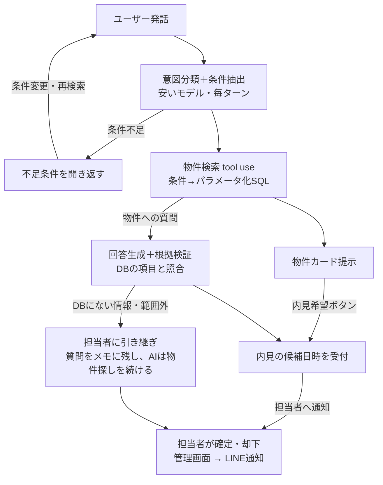

# LINE不動産問い合わせエージェント 設計書

作成日: 2026-10-07

## 1. 概要と目的

賃貸仲介会社向けに、LINEで届く物件問い合わせへ物件DBから回答し、内見の仮受付までをAIが一次対応するエージェントを1か月で作る。目的はAI受託案件を取るためのポートフォリオであり、「御社向けにこれを導入します」と提案できる商品見本にする。

### 差別化の中核（2点）

**1. 条件の優先順位を汲み取る**
Webサイトの絞り込み検索は、すべての条件が「必須」として扱われる。実際のユーザーの希望には濃淡があり、「駅徒歩10分と予算と2階以上が合っていれば、オートロックはなくてもいい」のような優先順位がある。LLMは会話からこの優先順位を汲み取り、必須条件で絞り込んだうえで残りをスコアで並べられる。「条件を1つ外せば候補が増える」提案もここから生まれる。

LLMの強みはスコアリングではなく会話にある。「静かなところがいい」を条件に翻訳すること、「オートロックを外すと7件増えますがどうしますか」とトレードオフを会話で提案すること、「やっぱり2階以上は必須」という途中の心変わりを自然に受けること。デモ動画はこの会話の流れを中心にする。

**2. 翌朝の担当者の仕事が「確定するだけ」になる**
賃貸の問い合わせは仕事帰りの夜と土日に集中するが、仲介会社の返信は翌営業日になり、その間にユーザーは他社へ流れる。24時間動くこと自体は定型ボットでもできるため差別化にならない。価値は翌朝に担当者の手元に何が残っているかにある。このエージェントは営業時間外でも条件ヒアリング・物件提示・質問回答・内見候補日の受付まで終え、聞き取れなかったことを要約し、担当者は「確定するだけ」の状態で引き継ぐ。営業時間を意識した応答と、翌朝の担当者が夜間分を一覧で拾える管理画面をセットで作る。

### 主要指標

発注者が買うのは内見予約率。主要指標は **「問い合わせ開始から内見候補日の提示まで到達した割合（到達率）」** とし、上の2つの差別化はこの指標を押し上げる工夫として示す。補助指標として、時間外開始の会話の到達率と、担当者が確定に要した時間（引き継ぎ→確定）を測る。

見せたい能力:

- **優先順位の理解**: 条件を「必須 / できれば / あれば嬉しい」に分け、一致度で並べて「何が合って何が合わないか」を示す
- **時間外対応の完結**: 営業時間外に届いた問い合わせが、翌営業日の朝には内見候補日つきで担当者の手元にある
- **設計判断**: ベクトル検索ではなく構造化検索を主にする理由、AIに確定させない業務範囲の線引き
- **本番品質**: ハルシネーション対策を後段検証で担保し、有人対応へ安全に引き継ぐ
- **数字で語れる改善**: 条件抽出の精度、禁止回答の検出率、応答時間とコストを評価セットで計測し、改善前後を示す

業務効果の訴求: 「夜間・休日の一次対応を自動化し、担当者の作業を内見の確定だけにする」

## 2. 機能要件

AIが担うのは「ヒアリング → 検索 → 提示 → 質問回答 → 内見の仮受付」まで。確定と例外対応は担当者が管理画面で行う。

### 2.1 LINE側（エンドユーザー）

| 機能 | 内容 | 入力手段 |
| --- | --- | --- |
| 条件ヒアリング | エリア・予算・間取り・駅徒歩・こだわり（ペット可など）を聞き取る。足りない条件は聞き返す | エリア・予算・間取りはクイックリプライ、こだわりは自由文 |
| 優先順位の確認 | 先に聞かない。エリアと予算が揃ったら即検索し、結果が0件または20件超のときだけ「この中で外せない条件はどれですか？」と聞く。結果を見せてから絞る体験にし、質問から始めない | クイックリプライで条件を複数選択 |
| 物件検索・提示 | 必須条件で絞り込み、残りの条件の一致度でスコア順に上位5件をFlex Messageのカルーセルで表示。各カードに「希望5件中4件に一致・オートロックなし」のように一致/未達を表示。「もっと見る」で次の5件 | 各カードに「詳細」「内見を希望」のpostbackボタン（物件IDを保持） |
| 条件変更・優先順位の変更 | どの段階でも「もう少し安いのは？」「やっぱり2階以上は必須」等で条件と優先度を差分更新し再検索 | 自由文 |
| 緩和提案 | 候補が少ないとき「オートロックを『できれば』にすると7件増えます」と、外す条件を具体的に提案する | クイックリプライで「外す」「外さない」 |
| 個別質問 | 「2番目の物件は駐輪場ある？」など、提示済み物件への質問にDBの項目のみで回答 | 自由文、またはカードの「詳細」ボタン |
| 内見の仮受付 | 希望物件と候補日時を2〜3件聞き取り、担当者へ通知。「担当者から確定のご連絡をします」と明示 | 日時はクイックリプライ（明日・今週末・来週）＋自由文 |
| 引き継ぎ | 空室状況・初期費用の確定額・DBにない情報は「担当者が確認します」で引き継ぐ。営業時間外なら「翌営業日（○月○日）にご連絡します」と具体的な日を示す | 自動 |
| 営業時間の認識 | 営業時間（既定: 平日10〜19時、水曜定休）を設定で持ち、時間外の会話では冒頭と引き継ぎ時に「営業時間外ですが物件探しはお手伝いできます」と案内する。内見候補日は翌営業日以降から提示する | 自動 |
| 冒頭案内 | 友だち追加時に「AIが一次対応し、担当者が確認します」と表示。ブロック解除で追加し直したときは条件・提示済み物件・内見の下書きを捨てて聞き直す（引き継ぎメモと有人対応の状態は残す） | 自動 |

### 2.2 管理画面（担当者）

| 機能 | 内容 |
| --- | --- |
| 朝の引き継ぎ一覧 | 前回の営業終了以降に届いた案件を「夜間・休日分」としてまとめて表示。各行に「希望物件・候補日時・AIが聞き取れなかったこと」を1行で要約し、担当者が上から順に確定していける。ステータス: 未対応 / 対応中 / 確定 / 却下 |
| 会話ログ | 1ユーザーの会話を時系列で閲覧。AIの回答と検索に使った条件（優先度つき）を表示 |
| 営業時間設定 | 曜日ごとの営業時間と定休日、祝日の扱いを設定。AIの時間外案内と内見候補日の提示に使う |
| 内見の確定・却下 | 候補日時から1つ選んで確定、またはコメント付きで却下。ユーザーへLINE通知 |
| 手動返信 | 担当者がLINEへ返信。返信した会話はAI自動応答を停止し、担当者が「AIに戻す」で再開 |
| 物件CSVインポート | CSVをアップロードして物件を一括登録・更新。取込時に備考からタグを自動抽出 |
| 認証 | Supabase Authのメール＋パスワード。1社用なのでロールは「担当者」のみ |

### 2.3 やらないこと（MVP外）

- AIによる内見予約の確定、空室確認、初期費用の確定額の提示
- 複数社対応（テナント分離）、物件の個別編集画面、画像アップロード
- SUUMO等の外部サイトからのデータ取得

## 3. 会話設計

状態を固定の順路にせず、**毎ターン意図を分類してから状態を参照する**。ユーザーは途中で条件を変えるし、提示後に新しい条件を言うので、状態は「次に何を聞くか」のヒントに留める。



条件変更は提示後でも検索へ戻り、根拠のない質問は担当者へ渡す。確定は常に人が行う。

### 3.1 意図の種類と状態

| 意図 | 処理 | 状態の移り先 |
| --- | --- | --- |
| 条件の提示・変更 | 条件スロットを差分更新し、揃っていれば検索。足りなければ1つだけ聞き返す | hearing → presenting |
| 提示物件への質問 | セッションに保存した提示リスト（表示順とID）から対象を解決し、DBの項目のみで回答 | presenting / qa |
| 内見希望 | 物件IDと候補日時を集め、揃ったら担当者へ通知 | booking → handed_off |
| 範囲外・雑談 | 定型で「物件探しのお手伝いをします」と戻す | 変化なし |
| 引き継ぎが必要 | 「担当者が確認します」と返し、質問を `handoff_notes` に残す（朝の一覧の「AIが聞き取れなかったこと」）。AIの応答は止めない（止めるのは担当者の手動返信だけ。3.4） | 変化なし |

### 3.2 条件スロット

| スロット | 型 | 正規化の例 |
| --- | --- | --- |
| エリア | 駅名（複数可）または区 | 「渋谷」→渋谷駅、「渋谷区」は区として扱う |
| 予算上限 | 円（家賃＋管理費と比べる） | 「7万」「7.0万円」「7万以内」→ 70000 |
| 間取り | 列挙（1R/1K/1DK/1LDK/2K/2DK/2LDK…） | 「ワンルーム」→1R |
| 駅徒歩 | 分 | 「駅近」→ 10分以内 |
| 階 | 下限 | 「2階以上」→ 2 |
| こだわり | タグの集合 | ペット可、独立洗面台、静か、日当たり良好 |
| 入居時期 | 年月 | 「来月」→ JSTで翌月 |

表記ゆれの正規化辞書はLLMの前段に置く。抽出精度はモデルよりここで決まることが多い。スロットとタグの語彙の正は `src/domain/types.ts`。

### 3.2.1 条件の優先度

各スロットは値に加えて優先度を持つ。これがWebサイトの検索と違う部分。

| 優先度 | 意味 | 検索での扱い | 抽出の手がかり |
| --- | --- | --- | --- |
| must | 外せない | 絞り込み条件（全か無か） | 「絶対」「必須」「じゃないと無理」、優先順位確認で選ばれた条件 |
| want | できれば欲しい | スコア加点（重み2） | 「できれば」「なるべく」「あったら嬉しい」、普通に挙げた条件の既定値 |
| nice | あれば嬉しい | スコア加点（重み1） | 「どっちでもいい」「あれば」、トレードオフ質問で「なくてもいい」と答えた条件 |

スロットのJSON例:

```json
{
  "area":     { "value": { "stations": ["渋谷", "中目黒"], "wards": [] }, "priority": "must" },
  "rentMax":  { "value": 90000, "priority": "must" },
  "walkMax":  { "value": 10, "priority": "want" },
  "floorMin": { "value": 2, "priority": "want" },
  "tags": [
    { "value": "バストイレ別", "priority": "must" },
    { "value": "オートロック", "priority": "nice" }
  ]
}
```

抽出ルール:

- 初回はエリアと予算を must、それ以外は want として扱う（明示がなければ）。この2つが揃った時点で検索し、先に優先順位を聞かない
- 優先順位を聞くのは、結果が0件（「どれを緩められますか？」）または20件超（「外せない条件はどれですか？」）のときだけ。1会話で1回まで。選ばれたものを must に昇格、または want に降格
- 数値条件は段階的に評価する。徒歩10分 want に対し12分の物件は部分点（0.6）を与え、全か無かにしない（徒歩は上限＋3分、予算は上限＋5,000円まで部分点。値は `src/domain/rules.ts`）
- 優先度の変更発話（「やっぱり2階以上は必須」「オートロックはなくてもいい」）は条件変更と同じ経路で差分更新する

### 3.3 複数物件の参照

- 提示したカードの順番と物件IDをセッションに保存し、「2番目の」「さっきの安い方」をそこから解決する
- カードの「詳細」「内見を希望」はpostbackで物件IDを運ぶ。ボタン指定を自由文より優先する
- 「AとBどっちが駅近？」の比較質問は、両方のレコードを取得して項目を並べて答える

### 3.4 有人対応への切替

- 担当者が手動返信した会話は `ai_paused` にし、AIの自動応答を止める。AIと人が同時に返信するのを防ぐ
- 再開は担当者の「AIに戻す」操作、または最終の担当者返信から24時間経過で自動
- 引き継ぎ時にはユーザーへ「担当者が確認します。営業時間内にご連絡します」と返す

### 3.5 禁止回答ルール

- 回答に使えるのは検索で取得したレコードの項目だけ。推測で補わない
- 空室状況、初期費用の確定額、周辺の治安・騒音、審査の可否は必ず引き継ぐ
- 回答生成後に、文中の数値・設備名がレコードの項目と一致するかを照合し、一致しない場合は定型の引き継ぎ文に差し替える

## 4. AI設計

構造化検索を主、ベクトル検索は補助に留め、LLMにSQLを書かせない。ハルシネーションはプロンプトの指示ではなく後段の照合で止める。

### 4.1 LLMの役割分担

| 工程 | モデル | 入出力 | 備考 |
| --- | --- | --- | --- |
| 意図分類＋条件抽出 | 安いモデル（Haiku級） | 発話＋現在のスロット → 意図・スロット差分（JSON） | 毎ターン実行。正規化辞書を前段に置く |
| 物件検索 | コードのみ | スロット → パラメータ化された検索関数 | LLMは関与しない |
| 回答生成 | 高性能モデル（Sonnet級） | 対象レコード＋質問 → 回答文・要引き継ぎ・禁止トピック | 対象物件は抽出の表示番号からコードが引いて渡し、構造化出力のツールを1回だけ呼ぶ（`src/lib/llm/answer.ts`。意思決定ログ6） |
| 根拠検証 | ルール（純関数） | 回答文＋レコード → 一致/不一致 | `src/domain/verify.ts`。不一致なら定型の引き継ぎ文に差し替え。安いモデルの検証は、評価セットでルールの取りこぼしを見てから足す |
| 取込時タグ抽出 | 安いモデル | 備考文 → タグ集合 | CSVインポート時に1回だけ実行 |

### 4.2 検索の使い分け

- **構造化検索（主）**: エリア・予算・間取り・徒歩・入居時期・タグは、列挙型と範囲指定だけを受けるパラメータ化関数で検索する。SQL文そのものはLLMに書かせない
- **2段階の検索**: must条件で絞り込み → 残った物件を want/nice の一致スコアで並べる（スコア降順 → 月額の安い順 → 物件ID昇順）。絞り込みもスコア計算もコードの純関数（`src/domain/search.ts`）で行い、LLMには関与させない（再現性と説明可能性のため）。絞り込みはSQLのWHEREではなく、公開物件を全件取得してから行う（数百〜数千件なら十分速く、緩和の試算が同じ関数で済む。意思決定ログ2）
- **一致の内訳を返す**: 検索関数は各物件に `matched: ["徒歩10分以内", "2階以上"]`, `unmatched: ["オートロックなし"]`, `score: 0.8` を付けて返し、回答生成とFlexカードの両方で使う。`unmatched` はそのまま表示できる不足の説明（「徒歩12分」「月額9.3万円」など）
- **候補が少ないときの緩和**: must条件を1つずつ want に下げて件数を試算し、「オートロックを『できれば』にすると7件増えます」と最も効果の大きい1つを提案する。エリア・予算・徒歩は下げずに（エリア外や予算超えまで混ざるため）、従来の「予算+5,000円 → 徒歩+5分 → 隣接駅」の緩和で扱う。下げて増える条件が無いときにこちらを提案する（`src/domain/relax.ts`）
- **タグ化（曖昧希望の主な受け皿）**: 「静か」「日当たり良好」「ペット可」などは取込時に備考から抽出して構造化列にする。200件なら十分で、評価も説明もしやすい
- **ベクトル検索（補助・後回し）**: タグに載らない自由文の希望を備考文で検索。埋め込みはClaude APIにないため外部の埋め込みAPIが必要になる。Week3以降に余裕があれば入れる

### 4.3 ハルシネーション対策

1. 回答に使えるコンテキストを、取得したレコードのフィールドだけに限定する（物件説明文の自由生成はしない。備考 `note` も渡さない）
2. 回答文から数値（家賃・管理費・月額・徒歩分・面積・階・築年・敷金礼金・入居可能日）と設備名・駅名・間取りを抜き出し、レコードの値と照合する。数値は比較のための物件どうしの差と築年数だけ計算を認め、単位の分からない数値は通さない。設備は「ある」と書いたらタグにあること、「ない」と書いたらタグに無いこと。タグに無い設備・周辺環境（エレベーター・駐車場・コンビニなど）と禁止トピックは「記載がありません」「担当者が確認します」の文脈でだけ認める
3. 禁止トピック（空室・初期費用確定額・治安・騒音・審査）を分類器で検出し、該当すれば回答生成をスキップして引き継ぎ文を返す。条件抽出が主で、回答生成も禁止トピックを申告でき、後段の照合も断定を落とす（三重）
4. 不一致が出た回答はログ（`messages.tool_calls` に生の回答と指摘）に残し、評価セットに追加する
5. レコードに無い情報を聞かれたら、答えられた部分に続けて定型の引き継ぎ文を返し、質問を `handoff_notes` に残す

### 4.4 応答時間とコスト

- 2回のLLM呼び出し（分類→生成）は応答時間がほぼ倍になる。単純な質問は高性能モデル1回のtool use呼び出しで完結する経路も用意し、両経路のp50/p95とコストを比較して評価に載せる
- システムプロンプトと検索関数定義はプロンプトキャッシュの対象にする。キャッシュには最小トークン数の条件があるため、短いプロンプトでは効かない可能性を確認する
- LINEのローディングアニメーションAPIで待ち時間の体感を下げる
- 1ユーザーあたりのレート制限（1分5発話）と1日のAPI費用上限を設け、超えたら「混み合っています」で止める

## 5. データ設計

テーブルは8つ（スキーマの正は `supabase/migrations/`）。会話の状態と提示済み物件リストを `conversations` に持たせ、AIの判断根拠を `messages` に残す。

| テーブル | 主な列 | 用途 |
| --- | --- | --- |
| properties | id, name, address, ward, access(JSON: `[{station, walk_min}]`、先頭が最寄り、1〜3件), rent, management_fee, deposit_months, key_money_months, layout, area_sqm, floor, built_year, tags(配列), note, available_from, status(public/private), updated_at | 物件マスタ。CSVから取込 |
| line_users | id, line_user_id, display_name, created_at | LINEユーザー |
| conversations | id, line_user_id, state(hearing/presenting/qa/booking/handed_off), slots(JSON), shown_property_ids(配列、表示順), shown_offset, last_search_total, priority_asked_count, ai_paused(bool), paused_at, last_staff_reply_at, booking(JSON: 内見の聞き取り途中), handoff_notes(JSON: 担当者へ回した質問), created_at, updated_at | 会話の状態。1 LINEユーザー1会話 |
| messages | id, conversation_id, role(user/ai/staff), text, intent, slot_diff(JSON), tool_calls(JSON), verification(ok/replaced), latency_ms, cost_usd, created_at | 会話ログと計測値 |
| viewing_requests | id, conversation_id, property_id, candidate_times(配列), status(pending/in_progress/confirmed/rejected), confirmed_time, staff_note, received_outside_hours(bool), created_at, updated_at | 内見の仮受付。時間外受付かを記録し、効果測定に使う |
| business_hours | weekday(0-6), open_time, close_time, is_closed | 営業時間設定（初期値: 10〜19時・水曜定休） |
| holidays | date, name | 祝日・臨時休業。年ごとに管理画面で設定する |
| webhook_events | webhook_event_id, received_at | 再送による二重処理の防止 |
| staff_users | Supabase Authのusersを利用 | 管理画面ログイン |

補足:

- `properties.tags` は取込時にLLMが備考から抽出した値（敷金なし・礼金なしは数値列から決める）。検索はこの列と数値列で行う
- `messages.verification` と `latency_ms` `cost_usd` を最初から記録し、評価レポートはこのテーブルから集計する。1日の費用上限は `sum_message_cost_since()` で集計する
- `line_user_id` は個人情報なので、管理画面では表示名のみ見せる
- 全テーブルで RLS を有効にし、Webhook は service role で読み書きする。管理画面のログイン済み担当者には必要な select/insert/update だけを許す。anon には何も許さない
- 会話ログの90日削除は `purge_old_messages()`（スケジュールは後で設定）
- ベクトル検索を入れる場合は `properties.note_embedding`（pgvector）を後から追加する

架空データ200件は、山手線・中央線・東急東横線沿いの駅を中心に、家賃6〜18万円、1R〜2LDKを分散させて生成する。実在の物件名・住所は使わない。

## 6. 技術構成

Next.js一本で管理画面とWebhookを持ち、Supabaseに状態を置き、Vercelに載せる。追加インフラは不要。

| 層 | 採用 | 理由 |
| --- | --- | --- |
| メッセージング | LINE Messaging API（Webhook、reply/push、Flex Message、postback、ローディングアニメーション） | 対象顧客の利用チャネル |
| アプリ | Next.js（App Router）、TypeScript。`/api/line/webhook` と管理画面を同居 | 1人で保守できる最小構成 |
| DB・認証 | Supabase（Postgres、Auth、RLS）。pgvectorは任意 | 構造化検索と認証を1サービスで済ませる |
| LLM | Claude API（tool use、プロンプトキャッシュ） | 役割分担は4.1のとおり |
| ホスティング | Vercel | デプロイが楽。Webhookの非同期処理に注意（6.1） |
| 担当者通知 | メール（Resend）＋管理画面の未対応一覧。Slack Webhookは任意 | LINE Notifyは終了しているため使わない |
| 評価・CI | Vitest、GitHub Actionsで評価セットを再実行 | 数字を再現可能にする |

### 6.1 Webhook処理の注意点

- Webhookは署名を検証してすぐ200を返し、LLM処理は `after()` または `waitUntil` で続行する。Vercelはレスポンス後に処理が打ち切られることがあるため、ここを最初に検証する
- 署名検証は加工前のリクエストボディで行う
- `webhookEventId` を保存し、再送による二重処理を防ぐ
- reply tokenは短時間で失効するため、処理が長引いた場合はpushに切り替える。pushは月間メッセージ枠を消費するので、送信数を見積もる
- Flex Messageのカルーセルは最大12バブル、1回の返信は最大5メッセージ、クイックリプライは最大13個。検索結果は上位5件＋「もっと見る」に分割する

### 6.2 環境変数

```
LINE_CHANNEL_SECRET
LINE_CHANNEL_ACCESS_TOKEN
ANTHROPIC_API_KEY
SUPABASE_URL
SUPABASE_SERVICE_ROLE_KEY
RESEND_API_KEY
DAILY_COST_LIMIT_USD
```

## 7. 評価設計

3指標を評価セットで計測し、CIで再実行できる形にする。改善前後の数字がポートフォリオの核になる。

| 指標 | 定義 | 評価セット | 目標 |
| --- | --- | --- | --- |
| **到達率（主要指標）** | 会話開始のうち、内見候補日の提示または引き継ぎまで到達した割合 | 公開デモの実ログ。シナリオテストでは期待到達を正解にする | 60%以上。時間帯別（営業時間内/外）に分けて示す |
| 条件抽出の正確さ | 抽出したスロットが正解と一致した割合（スロット単位） | 単発発話80件（表記ゆれ・複合条件・条件変更を含む） | 95%以上 |
| 優先度判定の正確さ | must / want / nice の判定が正解と一致した割合 | 上記80件のうち優先度の手がかりを含む40件＋トレードオフ質問への回答20件 | 90%以上 |
| 並び順の妥当性 | 人が付けた理想の順位との相関（nDCG@5） | シナリオ15本の検索結果 | 0.85以上。Webサイト式（全条件AND）との比較を載せる |
| 時間外の一次対応完了率 | 営業時間外に始まった会話のうち、内見候補日の受付または引き継ぎまで到達した割合 | 公開デモの実ログ（`received_outside_hours` で集計） | 70%以上 |
| 禁止回答の検出率 | DBにない情報を聞かれたとき、引き継ぎ文を返した割合 | 攻撃的質問40件（治安・騒音・空室・初期費用確定額・審査・近隣住民など） | 98%以上。取りこぼし0件が理想 |
| 応答時間とコスト | 1ターンのp50/p95レイテンシと、1会話あたりのAPI費用 | シナリオテスト15本の実行ログから集計 | p95で5秒以内、1会話10円以下 |

### 7.1 評価セットの作り方

1. 単発発話は自分で30件書き、残りはLLMに表記ゆれのバリエーションを生成させてから目視で正解を付ける
2. 攻撃的質問は「DBにない情報」「推測を誘う質問」「指示上書き（プロンプトインジェクション）」の3カテゴリで作る
3. シナリオテストは条件変更・複数物件の参照・比較質問・内見受付・有人切替を含む複数ターンの台本15〜20本。期待する状態遷移とツール呼び出しを正解にする
4. 本番ログで検証不一致になった回答は、評価セットに追加する

### 7.2 改善ループ

- 正規化辞書 → プロンプト → モデル選択の順に手を入れる。安い順に試して、どこで何%上がったかを記録する
- 2モデル構成と1モデルtool use構成を同じセットで比較し、精度・レイテンシ・コストを並べる
- 結果はREADMEに改善前後の表として載せる

## 8. 安全・法務面の配慮

AIに確定させない設計と、物件情報を推測で補わない設計が、そのまま法務面の対策になる。

| 論点 | 対応 |
| --- | --- |
| おとり広告（成約済み物件の案内） | `properties.status` が公開のものだけ検索対象にし、空室状況は常に「担当者が確認します」と返す。CSV取込で状態を更新できるようにする |
| 物件情報の正確性 | DBの項目以外を回答に含めない。根拠検証で不一致を差し替える |
| AI対応である旨の明示 | 友だち追加時と引き継ぎ時に「AIが一次対応しています」と表示する |
| 個人情報 | 氏名・電話番号はAIが聞き取らず、内見確定時に担当者が聞く。LINEユーザーIDは管理画面に表示しない。会話ログは90日で削除 |
| プロンプトインジェクション | ユーザー発話は常にデータとして扱い、ツール呼び出しはパラメータ化関数のみ。攻撃的質問セットで検証する |
| 公開デモの悪用 | ユーザーごとのレート制限と1日のAPI費用上限。架空データである旨をデモ画面に明記 |
| 免責表示 | 「回答は参考情報です。契約条件は担当者からの案内が優先されます」を物件カードの下に表示 |

## 9. 開発計画（4週間）

Webhookの非同期処理と構造化検索を最初に固め、評価は最終週にまとめて回す。遅れたら、ベクトル検索 → CSV取込の細かい検証 → 管理画面の装飾、の順に削る。

1. **Week 1: 土台**
   Supabaseスキーマ、架空データ200件の生成とCSV取込（タグ抽出込み）、Webhookの署名検証と `after()` による非同期処理の検証、意図分類＋条件抽出、パラメータ化検索関数
2. **Week 2: 会話の中核**
   Flex Messageの物件カードと「もっと見る」、提示済みリストの保持と複数物件の参照、回答生成（tool use）、根拠検証、0件時の緩和提案
3. **Week 3: 業務接続**
   内見の仮受付と担当者通知、管理画面（認証、未対応一覧、会話ログ、確定/却下、手動返信）、有人切替と自動再開、レート制限と費用上限
4. **Week 4: 評価と公開**
   評価セット作成（単発80件・攻撃40件・シナリオ15本）、CIでの自動実行、2構成の比較、公開デモ（QRコード・閲覧用アカウント）、README

各週末に動くデモを残し、Week 2終了時点で「検索して答える」だけは外部に見せられる状態にする。

## 10. ポートフォリオでの見せ方

発注者が見るのは「動くか」「数字で改善したか」「何をAIにやらせなかったか」の3つ。READMEと公開デモをその順で構成する。

### 10.1 公開するもの

- QRコードで友だち追加してその場で試せるLINEデモ（架空データ、レート制限つき）
- 閲覧用アカウントでログインできる管理画面
- GitHubリポジトリ（READMEに下記を記載）
- 2分のデモ動画。中心は会話の流れ: 「静かなところがいい」が条件になる → 0件で「オートロックを外すと7件増えます」の提案 → 「やっぱり2階以上は必須」の心変わり → 内見仮受付 → 翌朝の管理画面で確定。深夜に送って翌朝確定する時間の流れを字幕で示す

### 10.2 READMEに載せる数字

| 項目 | 載せ方 |
| --- | --- |
| 到達率（主要指標） | 全体と営業時間外の到達率を最初に出す。「全条件AND＋優先順位確認なし」のベースライン構成と比較し、2つの工夫でどれだけ上がったかを示す |
| 優先順位つき検索の効果 | 同じ会話を「全条件AND（Webサイト式）」と「must絞り込み＋スコア順」で検索し、ヒット件数と並び順の妥当性を並べる。「ANDでは0件、優先順位つきでは8件」のような例を1つ載せる |
| 条件抽出の正確さ | 改善前後（辞書なし → 辞書あり → プロンプト調整）の推移 |
| 禁止回答の検出率 | プロンプト指示のみ vs 後段検証あり、の比較 |
| 応答時間とコスト | 2モデル構成 vs 1モデル構成のp50/p95と1会話あたりの費用 |
| 時間外対応の効果 | デモログから「問い合わせの○%が営業時間外」「そのうち○%が内見候補日つきで翌朝の一覧に載った」を示す。担当者の初動が「翌営業日に返信」から「翌営業日に確定」へ変わることを図で見せる |
| 業務効果の試算 | 「夜間・休日の問い合わせ○%を自動で一次対応し、担当者の作業は内見確定のみ」の形で仮定を明示して示す |

### 10.3 設計判断の言語化

- なぜWebサイトの絞り込み検索ではなくLLMか（条件の優先順位を汲み取り、トレードオフを提案できる）
- なぜベクトル検索ではなく構造化検索を主にしたか
- なぜAIに予約を確定させないか、どこで人に渡すか
- ハルシネーションをプロンプトではなく後段検証で止める理由
- LINE/Vercel特有の制約（非同期処理、reply token、Flexの上限）にどう対処したか

### 10.4 受託提案への転用

「御社の物件CSVを流し込めば1〜2週間で同じものが動きます」と言える形にする。業種を変える場合（美容院の予約、士業の初回相談）も、検索関数と正規化辞書を差し替えれば流用できる構造にしておく。
